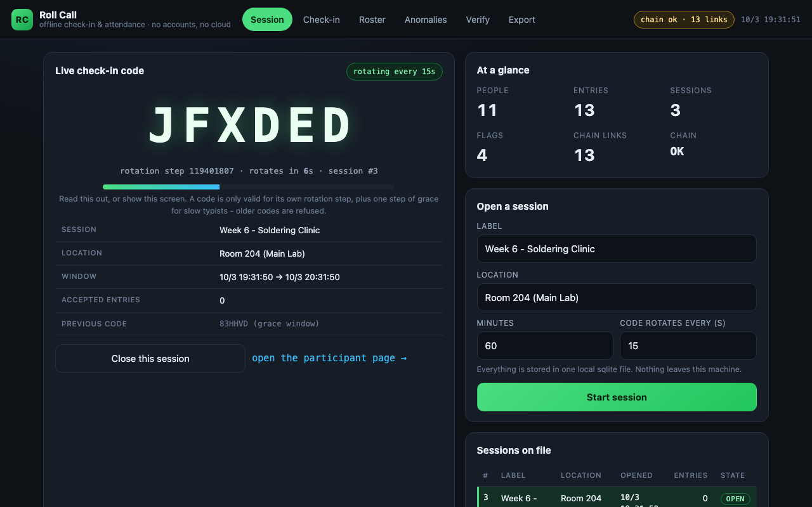

# Roll Call

**Offline-first check-in and attendance for a small class, club or workshop.**
A facilitator opens a session, the room checks in with a short code that rotates
every few seconds, and every check-in is sealed into a tamper-evident log that
flags duplicate entries, impossible travel, reused codes and check-ins outside
the session window. No accounts, no cloud, no QR hardware, no pip installs.



## Why

Small clubs keep attendance on paper or in a spreadsheet, and the moment you move
it online you inherit accounts, e-mail verification, a paid service and a privacy
problem. Roll Call is the smallest thing that is actually better than paper:

* **a code, not an account** - the facilitator's screen shows a six character code
  that changes every 15 seconds; a participant types it once and is done;
* **offline by construction** - `python3 app.py` serves the UI and the JSON API,
  and the state is one sqlite file you can copy to a USB stick;
* **evidence, not vibes** - every accepted check-in is hash-chained, and the four
  anomaly rules each print the rows they were derived from;
* **no vendor** - standard library only (Python 3.9), hand-written CSS and JS,
  MIT licensed.

## Run it

```bash
python3 app.py                                   # http://127.0.0.1:8080
python3 app.py --port 8782 --db /tmp/class.sqlite3
python3 app.py --demo                            # seed the demo history first
```

Open <http://127.0.0.1:8080/> as the facilitator. Hand
<http://127.0.0.1:8080/check-in> to the room (or put it on a phone-sized tab).

Screens: **Session** (the live code and its countdown, plus a form to open a new
session), **Check-in** (the participant page: code + reference + name),
**Roster** (who is present, entries, flags, per-participant summary),
**Anomalies** (every flag with its reason and evidence rows), **Verify** (hash
chain status, head hash, first broken link) and **Export** (CSV/JSON download plus
a preview). Every screen is addressable by URL (`/?view=roster`,
`/check-in?just=P-304`, `/?view=export&preview=summary.csv`), which is what the
demo video drives.

### Command line

```bash
python3 cli.py seed --demo              # 2 sessions, 13 sealed rows, 4 flags
python3 cli.py verify                   # walk the chain, print the first broken link
python3 cli.py verify --json
python3 cli.py anomalies                # the four rules, with evidence rows
python3 cli.py summary                  # per-participant attendance summary
python3 cli.py export csv -o register.csv
python3 cli.py export json -o register.json
python3 cli.py code                     # the live code, if you run the CLI headless
python3 cli.py tamper --row-id 4        # red-team helper: corrupt a row on purpose
```

`python3 cli.py verify` after `tamper` prints, for example:

```
CHAIN BROKEN after 3 verified link(s)
  row        : 4
  sequence   : 4
  reason     : payload_mismatch
  detail     : row 4 payload no longer hashes to its sealed value (fields changed or row forged)
  stored hash: 4f0b...9c1e
  recomputed : 91a7...0d42
```

### Test it

```bash
python3 -m unittest discover -s tests      # 64 tests
```

The suite covers code derivation and the grace window, the hash chain (including a
test that edits a row in sqlite and proves the first broken link is reported),
every anomaly rule branch, the service layer, the exports and the HTTP API - plus
an eight-client concurrent check-in test that asserts the chain stays linear.

### Demo video

`docs/media/roll_call_demo.mp4` (2:25) is generated by
`python3 tools/make_video.py`, which starts the app on port 8782, drives a real
session with headless Chrome screenshots (25 frames), corrupts a row in sqlite in
front of the camera, and muxes narration from edge-tts.

## How it works

**Rotating codes.** `code = HMAC-SHA256(session_secret, "rollcall/v1/code" ||
session_id:step)` rendered in a 29 symbol alphabet that has no `0/O`, `1/I/L` or
`2/Z` (`step = unix_time // step_seconds`). The server accepts the live step plus
one step of grace, and uses `hmac.compare_digest`. A code accepted from the older
step is recorded with `code_step < session_step` - that is the
*code reuse after rotation* signal.

**Hash chain.** `entry_hash = sha256("rollcall/v1/entry" || prev_hash ||
canonical_payload)` over `(seq, session_id, participant_id, kind, code_used,
code_step, session_step, checked_in_at, recorded_at, source)`; the previous link
of row 1 is 64 zeros. The head (last seq + last hash) is mirrored in
`chain_state`, so deleting rows from the end is detectable as well as editing
them. `verify` stops at the first broken link and reports it.

**Anomaly rules** (deterministic, each unit tested, each with evidence rows):

| rule | fires when | severity |
|---|---|---|
| `duplicate_check_in` | one person, two accepted check-ins in one session | high |
| `outside_session_window` | `checked_in_at` before `opens_at` or after `closes_at` | high |
| `code_reuse_after_rotation` | accepted with a code from an earlier rotation step, or the same code seen in two sessions | warn |
| `impossible_travel` | one person in two different-location sessions: `> 120 km/h` implied speed when coordinates exist, else less than 30 minutes apart | high |

Full specifications, the sqlite schema, the exact API surface and the export
formats are in [`docs/DESIGN.md`](docs/DESIGN.md).

## Threat model (what this does and does not protect)

**It does protect against**

* *guessing a code*: 29^6 (~5.9e8, ~29 bits) per rotation step, and a wrong code
  is refused; the codes are session-scoped, so a code from another session is
  useless;
* *typing a code you saw minutes ago*: once the rotation step has passed the grace
  window the code is `expired` - refused, and the attempt is logged in
  `rejected_attempts`;
* *quietly editing the register afterwards*: a changed attendance time, a
  re-attributed row, a deleted row or a hand-written row all make `verify` fail
  and name the first broken link;
* *check-ins from outside the session*, as long as the facilitator looks at the
  flags - they are recorded with the reason and the rows rather than hidden.

**It does not protect against**

* *a shoulder-surfer* who reads the code off the screen and types it inside the
  same rotation step. Rotating codes raise the cost of copying a code, they do not
  identify a person; that is what a human proctor is for.
* *"who is really P-104"*: references are self-declared. There is no account, no
  device binding and no biometrics, so one person can type another person's
  reference. Duplicate detection catches the lazy version (a second row).
* *a hostile host*: the sqlite file and the session secrets live on the same
  machine, and the hash chain is not signed with a key kept elsewhere. Anyone who
  can rewrite the whole database can recompute the whole chain consistently. The
  chain proves that *surgical* edits happened, not that a determined local
  administrator was honest.
* *traffic analysis and replay over the network*: the app speaks plain HTTP on
  localhost by design (keep it on the local network / use a reverse proxy with TLS
  if you expose it) and has no rate limiting.

## What I'd do next

1. **Anchor the chain** - email or publish the daily head hash (signed) so even a
   full database rewrite is detectable, and keep a keyed MAC of the head on a
   second device.
2. **Bring your own roster** - import a CSV of the expected class, so "who is
   absent" and the summary denominator stop depending on who happened to check in.
3. **Late joiners and sessions that move** - a proper "re-open with a new code"
   flow, plus a scheduled-session import from the club's calendar.
4. **Better travel evidence** - optional per-check-in room hints (a short room
   code on the door) so `impossible_travel` can be computed without coordinates.
5. **Export to the tools people already use** - an iCal/attendance sync and a
   printable sheet, keeping the local sqlite file as the source of truth.
6. **Make the log inspectable by non-programmers** - a per-row "why" panel that
   shows the payload, the previous hash and the recomputed hash side by side.

## Layout

```
app.py  cli.py                 entry points
rollcall/                      codes, chain, anomalies, service, exports, web, static/, demo
tests/                         64 unittest cases
docs/DESIGN.md                 data model, rules, API, exports
docs/media/                    demo video, thumbnail, screenshot
tools/make_video.py            rebuilds the demo video
```

MIT licensed. Python 3.9+, standard library only.
